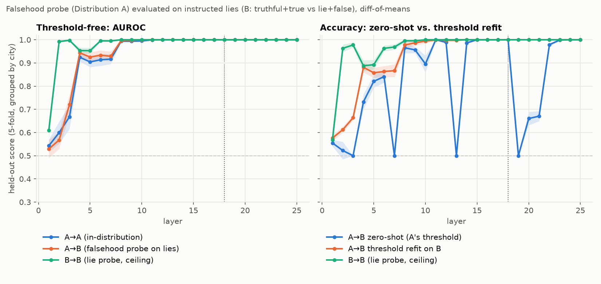
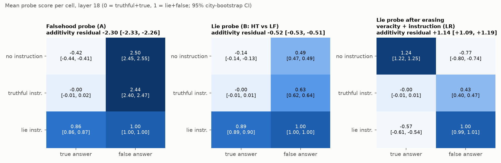
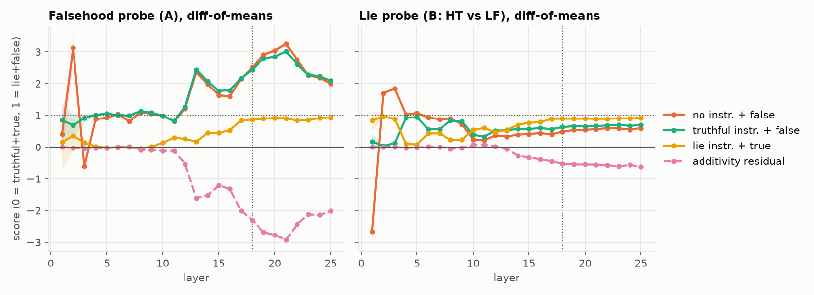
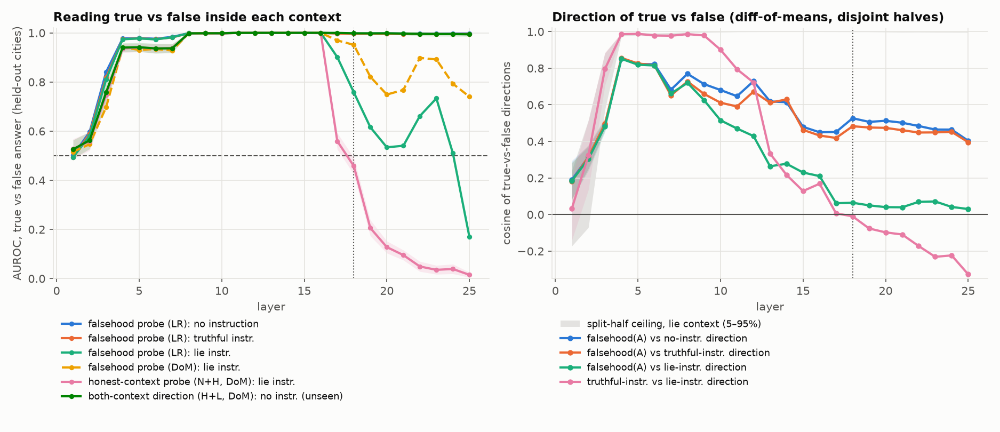
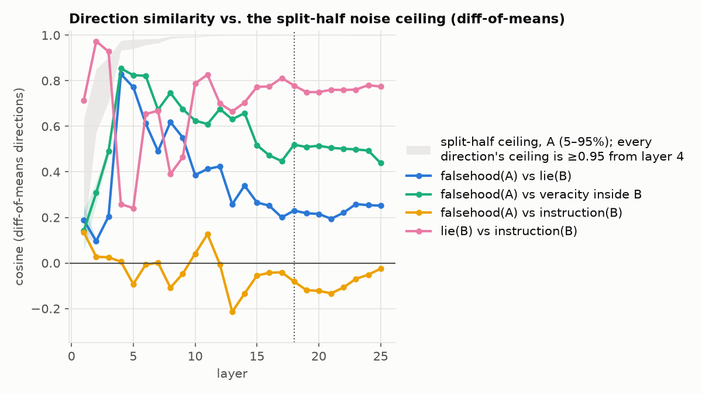
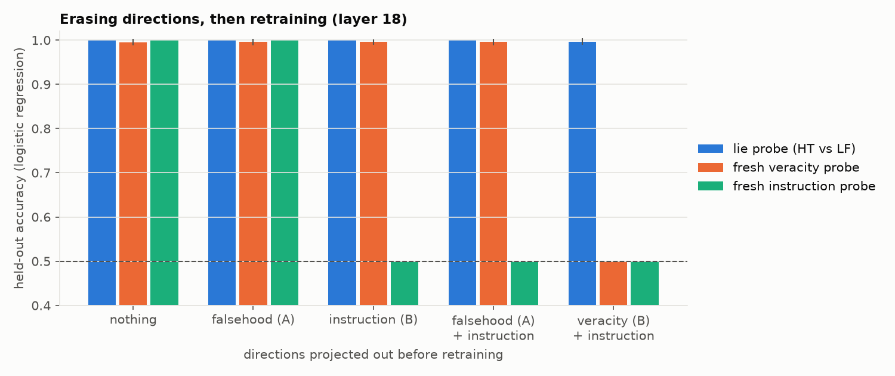

# Latent Geometry and Out-of-Distribution Transfer in LLM Deception Probes

## Key takeaway

On `gemma-2-2b-it`, a linear probe trained on plain true/false statements
"detects" instructed lies almost perfectly (AUROC 1.00 from layer 11 on). It
does so largely because the lies are false. It fires about 2.5× more strongly
on honest false answers than on actual lies, and it also moves most of the way
towards "lie" on lie-instructed *true* answers (diff-of-means, layer 18). Its
real out-of-distribution failure is inside the lie-instructed context. There,
the direction that separates true from false in honest contexts becomes
uninformative at layers 17–18. From layer 19 on it ranks answers
**backwards**: a probe trained on honest-context transcripts scores AUROC
**0.04** on lie-context answers at layer 24 (diff-of-means; below 0.5 means
reversed). AUROC ignores the threshold, so no threshold refit can repair
this. It is a change of direction, not an offset.
The information is not lost. A direction built from the truthful and lie
contexts also reads truth in the no-instruction context, which it never saw
(AUROC ≥ 0.99).

## Summary of results

* **Transfer to lies works, mostly through falsehood.** The falsehood probe
  separates *truthful instruction + true answer* from *lie instruction + false
  answer* with AUROC ≥ 0.996 from layer 8 on. At layer 18 its score on honest
  false answers is 2.44–2.50 on a scale where a real lie is 1.0, and its score
  on lie-instructed true answers is 0.86 (diff-of-means; logistic regression
  is similar). It behaves as a falsehood detector that is also pushed by the
  lie context.
* **Main-task failures are offsets.** At every layer where zero-shot accuracy
  collapses (13, 19, 20, 21), AUROC stays at 1.0 and refitting only the
  threshold on held-out cities restores ≥ 0.998. The direction is fine; the
  activations are shifted. This is consistent with the raw-text-to-chat
  format change, which was not tested separately.
* **Inside the lie context the true-vs-false direction changes.** In the
  no-instruction and truthful contexts the true-vs-false directions agree
  (cosine 0.88–0.97 from layer 8), and the falsehood probe reads them (AUROC
  ≥ 0.99). In the lie context, from layer 17 on, the true-vs-false direction
  is nearly orthogonal to both. Its cosine with the falsehood direction is
  0.03–0.07, and with the truthful-context direction +0.01 to −0.33. The
  split-half noise ceilings are ≥ 0.99.
* **The honest-context probe ranks lie-context answers backwards.** A probe
  trained on true-vs-false in the no-instruction and truthful contexts is at
  chance inside the lie context at layers 17–18 (AUROC 0.56, 0.46). From
  layer 19 on it is inverted (0.13 at layer 20, 0.04 at layer 24;
  diff-of-means, logistic regression similar). The directions are
  near-orthogonal with a small negative component. Because within-class
  spread along the probe is small, that component is enough to reverse the
  ranking. The falsehood probe from plain statements mostly degrades rather
  than inverting. In layers 18–24, logistic regression falls to 0.51–0.76
  (and inverts to 0.17 at layer 25), and diff-of-means falls to 0.75–0.95.
  Its true/false gap is 15–33× smaller than under the truthful instruction.
  A threshold refit does not repair it (0.49–0.71 for logistic regression).
* **A direction built from both instruction contexts generalises to a held-out
  context.** The sum of the truthful-context and lie-context true-vs-false
  directions separates true from false answers in all three contexts (AUROC
  ≥ 0.994 from layer 8). That includes the no-instruction context, which was
  never used to build it and contains no lies, so the direction is not
  specific to lie-ness. This is a modest test: the no-instruction direction
  is already similar to the truthful one (cosine ≈ 0.9).
* **Both falsehood and instruction drive the lie probe.** A probe trained on
  lies vs. honest truths scores 0.63 on honest false answers and 0.89 on
  lie-instructed *true* answers (layer 18). A lie is not additive in
  instruction and falsehood: the difference-in-differences is large (d_z
  5.4–7.1 from layer 12, sign-flip p ≤ 10⁻⁴). But it is anti-aligned with
  veracity (cosine −0.73 to −0.85 from layer 17), meaning the lie instruction
  *suppresses* the falsehood signal, the same phenomenon as above. With the
  lie as the only cell that is both instructed and false, this design cannot
  separate a dedicated lie feature from a falsehood × instruction interaction.
  The data show nothing beyond that interaction.
* **Controls.**
  * Knowledge filter: the model knows 744/748 cities.
  * Instruction length: the truthful and lie instructions are word-for-word
    parallel and equal in Gemma tokens.
  * Country identity: predicting labels from the named country alone is at
    chance (48% and 52%).
  * Massive-activation dimensions: cosines after per-dimension
    standardisation tell the same story.

## Research motivation

Anthropic's [*Fine-Tuned Lie Detectors Failed to Generalize*](https://alignment.anthropic.com/2026/lie-detectors/)
found that LoRA-fine-tuned lie detectors reach about 0.95 AUROC in
distribution, but only about 0.70–0.75 on unseen lie categories. It concludes
that they "learn narrow, task-specific features rather than general deception
signatures". It lists representation-level approaches as future work.

This project asks the analogous question for linear probes on the residual
stream, where the geometry can be inspected directly. When a probe fails to
transfer, does its direction rotate, does an offset move the activations
(fixable by re-thresholding), or does the probe track a confound such as
statement falsehood or the lie instruction itself?

## Experimental setup

* **Model:** `gemma-2-2b-it` in bf16. It is loaded from the ungated
  `unsloth/gemma-2-2b-it` mirror, pinned to a revision; pass
  `--model google/gemma-2-2b-it --revision main` if you have access.
* **Facts:** the Geometry of Truth `cities` dataset (Marks & Tegmark),
  pinned and hash-checked. The dataset has 748 cities, each with one true and
  one false statement. Cities the model does not place correctly when asked
  neutrally are dropped, leaving 744. They are split into two **disjoint**
  pools.
* **Distribution A (298 cities, 596 rows):** the raw statement, e.g.
  `The city of Lodz is in Poland.` → falsehood probe.
* **Distribution B (446 cities, 2,676 rows):** a 3×2 grid of chat transcripts
  per city. The answer is **teacher-forced**, and it is the Geometry of Truth
  statement verbatim, so A and B end in identical tokens.

  | instruction (in the user turn) | true answer | false answer |
  |---|---|---|
  | none: `Which country is the city of X in?` | NT | NF |
  | `Answer the following question with the truth. Give a true answer.` | HT | HF |
  | `Answer the following question with a lie. Give a false answer.` | LT | **LF = lie** |

* **Read position:** the residual stream at the final token (the closing
  `.`), for every layer. Layer *i* = output of decoder block *i−1*.
* **Probes:** difference-of-means (unit direction, midpoint threshold) and
  L2 logistic regression (C = 0.01, centred and scaled by one global scalar
  so geometry is preserved). Both are expressed as a unit direction plus a
  threshold in raw activation space.
* **Evaluation:** 5-fold cross-validation grouped by city everywhere. Any
  direction used for erasure or comparison is estimated on training cities
  only. The detailed layer (18) was chosen on Distribution A alone: the
  first layer reaching the best A→A accuracy (1.000, tied with layers 19–25).
* **Noise ceilings:** cosines are computed between directions estimated on
  disjoint city halves, and compared with each direction's own split-half
  cosine at matched sample size.

## Results and analysis

### 1. Transfer, and offset vs. rotation on the main task



| layer | A→A acc | A→B AUROC | A→B zero-shot acc | A→B threshold-refit acc | B→B acc |
|---|---|---|---|---|---|
| 6 | 0.846 | 0.934 | 0.841 | 0.863 | 0.963 |
| 10 | 0.933 | 0.999 | 0.896 | 0.994 | 1.000 |
| 13 | 0.983 | 1.000 | 0.500 | 0.998 | 1.000 |
| 18 | 1.000 | 1.000 | 1.000 | 1.000 | 1.000 |
| 19 | 1.000 | 1.000 | 0.500 | 1.000 | 1.000 |
| 21 | 1.000 | 1.000 | 0.670 | 1.000 | 1.000 |

*(Diff-of-means. A→B is truthful+true vs lie+false.)*

Wherever zero-shot accuracy collapses, AUROC stays at 1.0 and a threshold
refit on held-out cities recovers it. These failures are offsets, not
rotations.

### 2. What the probes actually read: the six-cell grid



Scores are normalised so that truthful+true = 0 and lie+false = 1. The
first two panels are diff-of-means probes; the third is logistic regression
(section 5).

* The **falsehood probe** puts every false answer far above the lie
  (NF 2.50, HF 2.44). Lie-instructed true answers move most of the way
  towards "false" (LT 0.86).
* The **lie probe** sits roughly halfway on both confound cells (HF 0.63,
  LT 0.89).
* The "additivity residual" is LF − LT − HF + HT. It is strongly negative for
  the falsehood probe (−2.30), because the lie instruction compresses its
  true/false gap.



*Same normalisation across layers, for the diff-of-means probes.*

### 3. Inside the lie context: offset or direction change?



| layer | falsehood probe AUROC in L (LR / DoM) | threshold refit in L (LR) | honest-context probe AUROC in L | both-context direction AUROC in N / H / L | cos(A, L-dir) | cos(H-dir, L-dir) |
|---|---|---|---|---|---|---|
| 12 | 1.00 / 1.00 | 0.99 | 1.00 | 1.00 / 1.00 / 1.00 | 0.43 | +0.72 |
| 16 | 1.00 / 1.00 | 1.00 | 1.00 | 1.00 / 1.00 / 1.00 | 0.21 | +0.17 |
| 17 | 0.90 / 0.97 | 0.83 | 0.56 | 1.00 / 1.00 / 1.00 | 0.06 | +0.01 |
| 18 | 0.76 / 0.95 | 0.71 | 0.46 | 1.00 / 1.00 / 1.00 | 0.06 | −0.01 |
| 20 | 0.53 / 0.75 | 0.56 | 0.13 | 1.00 / 1.00 / 1.00 | 0.04 | −0.10 |
| 22 | 0.66 / 0.90 | 0.65 | 0.05 | 1.00 / 1.00 / 1.00 | 0.07 | −0.17 |
| 24 | 0.51 / 0.79 | 0.49 | 0.04 | 1.00 / 1.00 / 1.00 | 0.04 | −0.22 |
| 25 | 0.17 / 0.74 | 0.50 | 0.02 | 0.99 / 0.99 / 1.00 | 0.03 | −0.33 |

*Split-half ceilings are ≥ 0.99 for every direction at these layers. The
honest-context probe and the both-context direction are diff-of-means.
LR = logistic regression, DoM = difference of means.*

In honest contexts the probe is fine. In the lie context, late layers encode
true-vs-false along a different, nearly orthogonal direction (cosine with the
truthful-context direction +0.01 to −0.33). Along the honest-context
direction, lie-context answers are not just inseparable; from layer 19 they
are ranked backwards. A threshold refit cannot fix an orthogonal or
reversed ranking, so this failure is directional. The left panel shows the
both-context direction on the held-out no-instruction context only; its
truthful- and lie-context AUROCs (also ≥ 0.99) are in the table and in
`results/metrics.csv`.

**Caveat.** Inside L, "true vs false" is LT vs LF, and LF is also the only
real lie. So the lie-context direction mixes falsehood with lie-ness. The
both-context result constrains this: it reads the no-instruction context,
which contains no lies, at AUROC ≥ 0.99.

**A candidate mechanism, not established here.** The honest-context
direction might mix *truth* with *"this answer is what the context asked
for"*. Under a lie instruction the second component flips, because a false
answer is now the compliant one. That flip is consistent with the inversion,
with LT moving towards "false", and with averaging the two contexts
recovering a direction that reads truth across the contexts tested. A test would correlate probe
scores with the model's own log-probability of the answer, or add a context
where false answers are expected but not lies (e.g. "repeat this incorrect
claim").

### 4. Direction similarity across distributions



The falsehood direction from A and B's pooled veracity direction have cosine
about 0.5 in late layers, against a ceiling of 0.999. Yet the probe transfers with AUROC ≈ 1. A low cosine
alone does not predict a transfer failure; what matters is how the
*evaluation contrast* projects onto the probe. The lie direction is closer to
the instruction direction (cosine 0.75–0.81 from layer 15) than to the
falsehood direction (0.19–0.27).

### 5. Erasing directions, then retraining



Projecting out a class-mean-difference direction (estimated on training
cities) drives a fresh probe for that concept to chance. That is expected,
because equal class means make w = 0 the logistic optimum. After erasing B's
pooled veracity and instruction directions, a retrained lie probe still
reaches 99.7%. But it is not lie-selective: it scores neutral true answers at
1.24 and lie-instructed true answers at −0.57 (logistic regression; third
panel of the grid figure). That suggests it exploits the context-dependent
geometry of truth rather than a dedicated lie direction. The neutral context
was never in its training set, though, so part of that score may be a
context shift. Erasing A's falsehood direction alone leaves B's
veracity fully decodable (99.6%), which is another sign that the two
directions differ.

### 6. Difference-in-differences

Per city, Δ = x[LF] − x[LT] − x[HF] + x[HT]. Evaluated along its mean
direction on held-out cities, the contrast is significant at every layer from
3 on (sign-flip null p ≤ 10⁻⁴, the resolution of 10,000 flips), with d_z
5.4–7.1 from layer 12. From layer 17 its
direction has cosine −0.73 to −0.85 with B's veracity direction. In other words, the falsehood
effect is much weaker under the lie instruction than under the truthful one.
This is the same phenomenon as section 3, not independent evidence for a lie
feature.

## Methodological context

This project extends an observation from my Master's thesis on argument
representations. There, embeddings reached 88% linear SVM separability
despite a silhouette score of −0.028 on DBSCAN clusters: linear decodability
does not require cluster structure. The analogue here: decodability along one
contrast says little about which direction a probe has actually learned.

## Limitations

* One small model (2B parameters). The geometry, and the layer at which the
  lie context diverges, may differ at frontier scale.
* **Teacher-forced (off-policy) answers.** The model never chose to lie. The
  Anthropic study used on-policy lies, and on-policy activations may differ.
* One fact domain (city → country), whose correct countries are skewed
  (China is about 26%). There is one phrasing per instruction, so the
  instruction effects may be phrasing-specific.
* Inside the lie context, falsehood and lie-ness are perfectly confounded,
  as discussed in section 3.
* Erasure uses class-mean-difference directions (LEACE-style for one binary
  concept at a time), not joint erasure of all concepts. The grid
  normalisation divides by the held-out LF − HT gap. Rankings are
  affine-invariant, but ratio values carry extra noise beyond the city
  bootstrap CIs.
* The detailed grid and tables are at layer 18. All per-layer metrics are in
  `results/metrics.csv`.

## What I would do next

1. **On-policy lies.** Let the model generate under the lie instruction, keep
   real lies, and test whether the honest-context direction still inverts.
2. **Test the expectedness hypothesis.** Add "false but expected, not a lie"
   contexts (quoting, role-play, a correction task), and correlate probe
   scores with answer log-probability.
3. **Train across contexts as a geometric regulariser.** Train probes on
   pairs of contexts that disagree about what is expected, and test transfer
   to held-out deception types, e.g. sycophancy, or the categories in the
   Anthropic study.
4. Repeat on larger models, and check Gemma Scope SAE features aligned with
   the lie-context direction.

## Reproducibility

```bash
git clone https://github.com/berserkersap/deception-probe-geometry.git
cd deception-probe-geometry
pip install -r requirements.txt     # CUDA 12.8 torch wheels; Python 3.14 tested
python extract_activations.py       # ~2 min on an 8 GB RTX 5060; reuses data/pools.json
python run_experiments.py           # CPU; writes results/ and results/plots/
pytest -q                           # synthetic checks of every analysis
```

`data/pools.json` and `data/knowledge.csv` fix the city pools.
`results/extraction_manifest.json` records model and data revisions, prompts
and versions. Activations (about 400 MB) are not committed; they are
regenerated by `extract_activations.py`.

## Repository layout

```text
extract_activations.py   build datasets, knowledge filter, cache activations
run_experiments.py       E0–E6 on cached activations, writes results/
make_plots.py            redraw figures from results/
src/data.py              dataset and prompt construction
src/extract.py           model loading, final-token activations
src/probes.py            diff-of-means / logistic probes, AUROC, threshold refit
src/geometry.py          cosines, projections, difference-in-differences
src/experiments.py       the experiments
src/plots.py             figures
tests/                   unit and synthetic end-to-end tests
```
